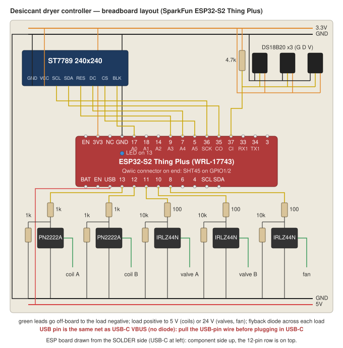
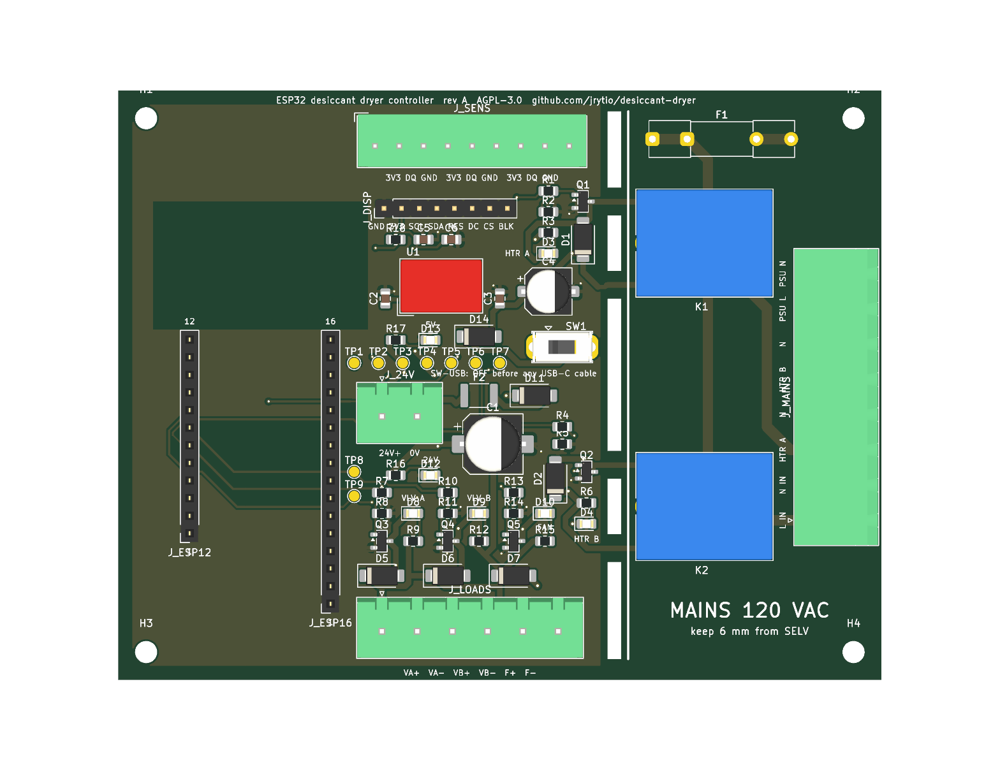
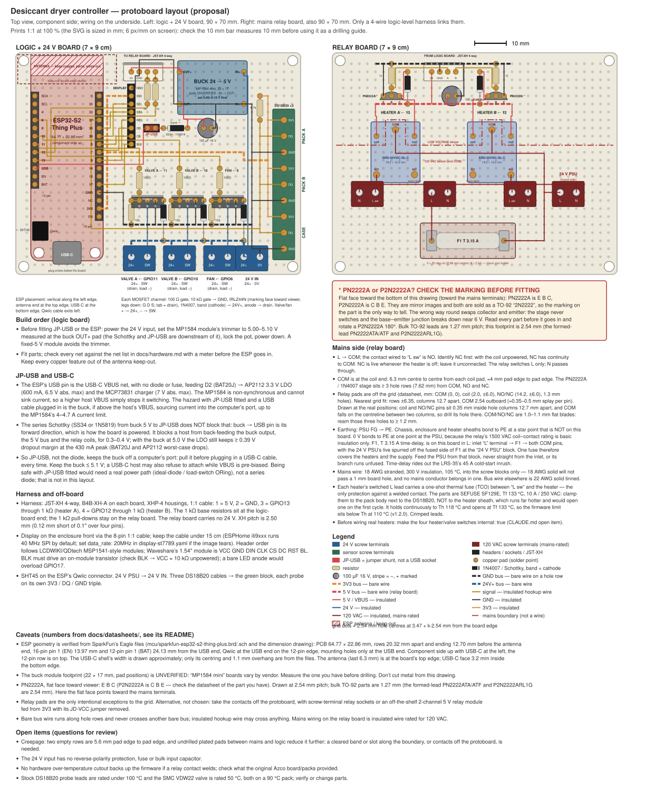

# Hardware

## Bill of materials (protoboard build)

The driver, buck and Schottky rows below (PN2222A, IRLZ44N, 1N4007, MP1584,
the USB-pin Schottky and JP-USB) describe the protoboard build. The PCB's
own parts are in the [Printed circuit board (rev A)](#printed-circuit-board-rev-a)
BOM. The off-board items (MCU, sensors, display, relays, valves, fan,
supply, heaters and thermal fuses) apply to both.

| Item | Part | Notes |
|---|---|---|
| MCU | SparkFun ESP32-S2 Thing Plus (WRL-17743), or SparkFun Thing Plus ESP32-C6 (DEV-22924) | Same sockets and wiring for either. The C6 needs two jumpers cut first: [Fitting an ESP32-C6 Thing Plus](#fitting-an-esp32-c6-thing-plus) |
| Humidity/temp | Sensirion SHT45 breakout (Qwiic/STEMMA QT) | In outlet air, after the valves |
| Pack/case temp | 3× DS18B20 (probe style) | Shared 1-wire bus, 5.1 kΩ pullup, 125 °C max |
| Display | 1.54" IPS 240×240, ST7789 | 4-wire SPI, no MISO needed |
| Heater relays | 2× Songle SRD-05VDC-SL-C | 5 V coil ~70 mA, 10 A / 250 VAC contacts |
| Relay drivers | 2× PN2222A (TO-92, E-B-C); do not substitute P2N2222A unless rotated 180° | 1 kΩ base (logic-board end), 1 kΩ base pulldown (relay board) |
| Valve/fan drivers | 3× IRLZ44N | 100 Ω gate, 10 kΩ gate pulldown |
| Flyback diodes | 5× 1N4007 (or Schottky) | Across every coil/fan, band (cathode) to + |
| Valves | 2× SMC VDW22QABXB | 24 VDC, 3 W, 2-port NC, brass |
| Fan | 24 V axial | On/off only |
| Supply | 24 V, 1.5 A (e.g. Mean Well LRS-35-24) | Whole system ~12 W; open-frame Class I: FG to PE, guard the mains terminals |
| Buck | MP1584 "mini" 24 V → 5 V module (22 × 17 mm, trimmer), or a fixed-5 V module | Feeds board USB pin (through the Schottky) and relay coils; set to 5.00–5.10 V |
| USB-pin Schottky | SS34 (SMD) or 1N5819 (axial) | Buck 5 V → JP-USB → board USB pin |
| Heaters | 2× 120 VAC, 123 Ω (~117 W) | Existing packs; switched by relay contacts |
| Heater over-temp cutouts | 2× SEFUSE SF129E one-shot thermal fuse (TCO), Tf 133 °C, Th 118 °C, 10 A / 250 VAC | In series with each heater's switched L lead, clamped to the pack body next to the DS18B20. Its holding temperature sets the `overtemp` latch — see [Mains and earthing](#mains-and-earthing) |

Protoboard build (see [Protoboard layout](#protoboard-layout-previous-build)), in
addition to the parts above. The PCB's own parts list is under
[Printed circuit board (rev A)](#printed-circuit-board-rev-a).

| Item | Part | Notes |
|---|---|---|
| Logic board | Double-sided plated FR-4 protoboard, 7 × 9 cm | 2.54 mm grid |
| Relay board | Double-sided plated FR-4 protoboard, 7 × 9 cm | Same stock as the logic board. 5 × 7 cm has no 23 mm clear run for the fuse holder once the four mains blocks are in |
| ESP sockets | 1× 16-pin and 1× 12-pin female header, 2.54 mm | ESP is socketed |
| Bulk capacitors | 2× 100 µF / 16 V electrolytic | 5 V on each board; mind polarity |
| JP-USB | 2-pin header + shunt | Manual disconnect between buck and USB pin |
| Harness | JST-XH 4-way: B4B-XH-A header on each board, 2× XHP-4 housings, crimps, cable | Or an equivalent keyed 0.1" housing |
| Display cable | 8-pin male header + 8-way female-female cable ≤ 15 cm | |
| Resistors | 5.1 kΩ (1-wire pullup) plus the driver-stage resistors above | 4.7 kΩ is the usual DS18B20 value and also works; the protoboard was built with 5.1 kΩ, which is fine for three probes on short leads |
| Sensor terminals | 9-position 5.08 mm screw terminal block | DS18B20 ×3 |
| 24 V terminals | 4× 2-position 5.08 mm screw terminal block | 24 V in, valve A, valve B, fan |
| Mains terminals | 4× 2-position 5.08 mm **mains-rated** screw terminal block (UL 1059 300 V / 10 A or IEC 250 V class) | 120 VAC in, heater A, heater B, 24 V PSU feed |
| Mains fuse | T 3.15 A 5 × 20 mm fuse + PCB clips or block holder | **F1**, on the relay board in L between the inlet terminal and both COM pins. Clips drawn on 22.86 mm centres (9 × 2.54) — check yours — see [Mains and earthing](#mains-and-earthing) |
| Mounting | M3 nylon standoffs | Board corners |
| Wire | 22 AWG solid tinned bus wire; 24–26 AWG insulated hookup; 22 AWG stranded for 24 V; 18 AWG stranded 300 V / 105 °C for mains | Sizes and reasoning under [Wire sizes](#wire-sizes) |

Datasheets for these parts, with sources and revisions, are in
[datasheets/README.md](datasheets/README.md).

## Board pinout used

The GPIO numbers in this document are the ESP32-S2 board's. The wiring is
by header position and is the same for the ESP32-C6 board, whose numbers
are in the table under
[Fitting an ESP32-C6 Thing Plus](#fitting-an-esp32-c6-thing-plus).

From SparkFun's Eagle schematic (J4 = 16-pin, J2 = 12-pin); pin-by-pin
tables and sources in [pinout-verification.md](pinout-verification.md).

16-pin header, in order: RESET (EN/CHIP_PU), 3V3, NC, GND, A0=17, A1=18,
A2=14, A3=9, A4=7, A5=5, SCK=36, COPI=35, CIPO=37, RX1=33, TX1=34, 3.
Used: 3V3, GND, 17 (backlight PWM), 9 (display RST), 7 (display DC),
5 (display CS), 36 (SCK), 35 (MOSI), 37 (1-wire bus).

12-pin header, in order: BAT, LDO EN, USB, 13, 12, 11, 10, 8, 6, 4, SCL=2,
SDA=1.
Used: USB (5 V in), 13 (heater A), 12 (heater B), 11 (valve A), 10 (valve B),
8 (fan). Note the "9" and "5" Feather positions are GPIO8 and GPIO4 here.
Qwiic connector: SDA=1, SCL=2, 3.3 V, GND.

The two "EN" pins are different nets; neither is used. 16-pin #1 is the
ESP's CHIP_PU (the module's EN pin), silkscreened RST on the component
side and RESET on the back: R10 10 kΩ to 3.3 V, C8 0.1 µF, the RESET
button and the auto-reset transistor Q2. Pulling it low resets the ESP.
12-pin #2, silkscreened EN, is the AP2112 regulator's enable, R8 100 kΩ
to VIN. Pulling it low turns the 3.3 V rail off; it is not a reset.

Both header orders above run from the USB end. Component side up with the
USB-C at the left, the 12-pin row is on top and the 16-pin row at the bottom.

On-board blue LED: GPIO13 via 1 kΩ, active high (lights with heater A).
Avoid: GPIO0 (boot button), GPIO19/20 (USB D-/D+), 45/46 (strapping, back
pads only). GPIO18 has an optional pullup (solder jumper, open by default).
GPIO33–37 are free on this quad-SPI module.

## Fitting an ESP32-C6 Thing Plus

The SparkFun Thing Plus ESP32-C6 (DEV-22924) goes in the same two sockets
as the S2 board, with no change to either protoboard. It runs its own
firmware image (`esphome/desiccant-dryer-c6.yaml`); the published manifest
carries both images and each board takes its own. The source and the
reasoning for every line here are in
[pinout-verification.md](pinout-verification.md#thing-plus-esp32-c6-dev-22924).
None of it has been run on a C6 yet.

Before the board goes in a socket:

1. **Cut jumpers ALRT and SD_DET** on the back of the C6 board (a knife
   through the trace between the two pads; a solder blob restores it).
   ALRT ties valve A's pin to the battery gauge's alert output. SD_DET ties
   heater B's pin to the card-detect switch.
2. **Check both cuts with a meter, board unpowered:** no continuity across
   either jumper's two pads. That is the whole test. A resistance reading
   from the header pin to 3V3 is not one: it depends on which way round the
   meter leads are, because the chip's input protection conducts one way.
3. **Leave the µSD slot empty** and tape over it. The slot shares the
   display's SPI lines, the 1-wire bus and heater A's line.
4. Leave the other jumpers (LP, I2C, RGB, CHG, PWR, SHLD, MEAS) as
   delivered, and solder the headers on as for the S2.
5. **Flash it before seating it**, over USB-C, from the published manifest
   (docs/releasing.md). Seated, the fan's gate pulldown holds the chip's
   GPIO8 boot strap low, and download mode with GPIO8 low is not a valid
   boot mode for the C6. The JP-USB rule (SW-USB on the PCB) is the same as for the S2: never
   a USB cable and the buck's 5 V together.

The same header positions, with each board's GPIO:

| Position | Function | S2 GPIO | C6 GPIO |
|---|---|---|---|
| 16-pin 5 | display backlight | 17 | 0 |
| 16-pin 8 | display RST | 9 | 3 |
| 16-pin 9 | display DC | 7 | 4 |
| 16-pin 10 | display CS | 5 | 5 |
| 16-pin 11 | SPI clock | 36 | 19 |
| 16-pin 12 | SPI data | 35 | 20 |
| 16-pin 13 | 1-wire | 37 | 21 |
| 12-pin 4 | heater A | 13 | 18 |
| 12-pin 5 | heater B | 12 | 22 |
| 12-pin 6 | valve A | 11 | 11 |
| 12-pin 7 | valve B | 10 | 10 |
| 12-pin 8 | case fan | 8 | 8 |
| 12-pin 11 / 12, Qwiic | I2C SCL / SDA | 2 / 1 | 7 / 6 |

Differences that show up in use:

- The C6 board's 12-pin silkscreen reads GPIO0 to GPIO6. Those are header
  labels, not the chip's GPIO numbers.
- No LED lights with heater A: the S2's blue LED on GPIO13 has no
  counterpart.
- The USB port is the chip's own (`/dev/cu.usbmodem*` on macOS), not a
  CP2102.
- RESET is pulled up by 100 kΩ where the S2 has 10 kΩ, so the pin
  tolerates a tenth of the leakage. Keep flux off that end of the socket.
- Four positions the wiring leaves empty must stay empty, because the C6
  gives them a job: 16-pin 16 (BOOT), 16-pin 15 (UART0 TX), 12-pin 10
  (a boot strap) and 12-pin 9 (the RGB LED).

## Driver stages

Relay channel (×2):

```
  GPIO ──[1 kΩ]──┬── base   PN2222A
                 │          emitter ── GND
              [1 kΩ]        collector ── relay coil ── +5 V
                 │                       (1N4007 across coil, band (cathode) to +5 V)
                GND
  relay NO contact switches L to the 120 VAC heater
```

The base pulldown was specified as 10 kΩ; the protoboard was built with
1 kΩ, tested there, and kept. The pulldown takes about 0.75 mA of the
~2.55 mA through the series resistor, leaving roughly 1.8 mA of base drive
(2.5 mA with 10 kΩ) for a ~72 mA coil: a forced gain of about 40 against
the PN2222A's minimum hFE of 75–100 in this range, so the stage still
saturates, with less margin. The stronger pulldown holds the relay off
harder while the ESP boots or is out of its socket. Keep the 1 kΩ values
the right way round: 10 kΩ in series with 1 kΩ to ground leaves the base
near 0.3 V and the relay never pulls in. With the harness plugged in, a
GPIO13/12 socket position reads about 2 kΩ to GND, base to GND about 1 kΩ.

MOSFET channel (×3, valves + fan):

```
  GPIO ──[100 Ω]──┬── gate   IRLZ44N
                  │          source ── GND
               [10 kΩ]       drain ── load ── +24 V
                  │                   (1N4007 across load, band (cathode) to +24 V)
                 GND
```

At 3.3 V gate drive the IRLZ44N is only partly enhanced (~40–50 mΩ). Fine for
the 125 mA valves and a small fan; not intended for heavy loads.

Package pinouts: PN2222A TO-92, flat face toward you, legs down: E B C
(P2N2222A, also sold as a TO-92 "2N2222", is C B E; check the datasheet of
the part you have). Bulk TO-92 lead pitch is 1.27 mm; the formed-lead
PN2222ATA/ATF and P2N2222ARL1G are 2.54 mm. IRLZ44N TO-220, marking face
toward you, legs down: G D S. Tab is tied to drain.

## Breadboard layout (bench build)



GPIO labels in the drawing are the ESP32-S2 board's. The wiring is by
header position and is the same for the ESP32-C6 board
([table](#fitting-an-esp32-c6-thing-plus)).

The ESP board in this picture is drawn from its solder side; component side
up with USB-C at the left, the 12-pin row is on top.

- Top rails: 3.3 V and GND from the board's 3V3/GND pins.
- Bottom rails: 5 V and GND from the buck converter. 24 V supply negative
  ties to the same ground.
- Board USB pin ← bottom 5 V rail. That pin is the USB-C connector's VBUS
  net, with no diode or fuse before it, so pull the USB-pin wire before
  plugging in a USB-C cable, or flash over the air. The buck can't be
  back-fed (the MP1584 is non-synchronous and cannot sink current; a higher
  host VBUS just stops it switching), but a buck set above the host's VBUS
  sources current into the computer's port, up to the MP1584's 4–4.7 A
  current limit. Only pulling the wire (or JP-USB on the protoboard) prevents
  that; the protoboard's series Schottky blocks the other direction only
  (see JP-USB below).
- Display: GND/VCC to top rails; SCL→36, SDA→35, RES→9, DC→7, CS→5, BLK→17.
- DS18B20 ×3: all GND to top GND, all VDD to top 3.3 V, all DQ tied together
  → GPIO37 with one 5.1 kΩ to 3.3 V. Three-wire hookup; do not use parasitic
  power.
- SHT45: Qwiic cable to the board's connector; nothing on the breadboard.
- Five driver columns below the board, one per output. Relays and the 24 V
  loads live off-board; only the coil/load negative lead returns to the
  transistor collector/drain.
- Nothing above 24 V on the breadboard. Heater contacts and mains wiring go
  on the relay module / a terminal block in the enclosure.

## Printed circuit board (rev A)



One 110 × 85 mm two-layer board replaces both protoboards and the harness.
It takes the same socketed Thing Plus (S2 or C6) at the same header
positions, so the firmware, the board packages and the pin map are
unchanged. The mains side is the strip at x ≥ 72.5 mm, behind a 2 mm
routed slot; the slot has four gaps, one for each relay coil track. Every
field connection is a pluggable header with its own pitch and pin count,
so no plug fits another header, except that a smaller plug of the same
pitch does enter a larger header: the 6-pin J_LOADS plug fits the 8-pin
J_MAINS header, so the silkscreen labels and the loom's own labelling are
the defence between them, and a different pitch for J_LOADS is a rev B
option. JLCPCB fabricates and assembles it, SMD and
through-hole, all on the top side. The hand work is seating the ESP,
soldering the 5 V module U1 (not stocked at LCSC, see the BOM) and fitting
the T 3.15 A fuse in F1's holder. Nothing in this section has been built yet.

The design is generated from `hardware/dryer_board/` (commands, CI and
ordering in [hardware/README.md](../hardware/README.md); design in
[the PCB spec](superpowers/specs/2026-10-14-pcb-design-kicad-design.md),
whose "As built" section lists where the board differs from it). Review
files, regenerated by `scripts/hardware.sh export`:
[top-view SVG](hardware/top.svg) (prints 1:1),
[isometric render](hardware/render-iso.png),
[schematic PDF](hardware/schematic.pdf).

### What differs from the protoboard

- 24 V input protection: a 1.1 A PPTC (F2) and a series SS34 Schottky
  (D11) for reverse polarity, then 100 µF / 50 V bulk. The loads see 24 V
  less the SS34 drop.
- A fixed 5 V module (U1) in place of the MP1584 buck: no trimmer to set.
- SMD drivers: MMBT2222A relay drivers, CJ2310 MOSFETs (60 V, SOT-23) in
  place of the IRLZ44N, MDD M7 flybacks (S1M class, 1 A 1000 V) in place
  of the 1N4007.
- Seven status LEDs (table below).
- A slide switch, SW-USB, in place of the JP-USB shunt.
- One 8-pin mains plug in place of four 2-position mains blocks; one
  6-pin load plug in place of three 24 V blocks.
- No harness: the relay stages sit on the same board as the ESP.
- Test points TP1 to TP9: GND, 3V3, 5 V, 24 V and the five output drive
  nets at the ESP side of their series resistors.
- Component values the protoboard settled are kept: 1 kΩ base series and
  1 kΩ base pulldown, 100 Ω gate and 10 kΩ gate pulldown, 5.1 kΩ 1-wire
  pullup.

### Bill of materials

Generated from `hardware/dryer_board/circuit.py` (the part descriptions
there carry maker, part number and JLCPCB class). Test points TP1 to TP9
and mounting holes H1 to H4 are bare pads and holes, not parts. Datasheets
for every part are in [datasheets/](datasheets/README.md).

| Reference | Qty | Value | Footprint | LCSC | JLCPCB |
|---|---|---|---|---|---|
| C1 | 1 | 100u 50V | `CP_Elec_8x10.5` | C294509 | extended |
| C2 | 1 | 10u 50V | `C_0805_2012Metric` | C440198 | basic |
| C3 | 1 | 22u 10V | `C_0805_2012Metric` | C45783 | basic |
| C4 | 1 | 100u 16V | `CP_Elec_6.3x7.7` | C231174 | extended |
| C5 | 1 | 100n | `C_0805_2012Metric` | C49678 | basic |
| C6 | 1 | 10u 10V | `C_0805_2012Metric` | C15850 | basic |
| D1, D2, D5, D6, D7 | 5 | S1M | `D_SMA` | C95872 | basic |
| D3, D4 | 2 | LED red | `LED_0805_2012Metric` | C84256 | basic |
| D8, D9, D10 | 3 | LED yellow | `LED_0805_2012Metric` | C2296 | basic |
| D11, D14 | 2 | SS34 | `D_SMA` | C8678 | basic |
| D12, D13 | 2 | LED green | `LED_0805_2012Metric` | C2297 | basic |
| F1 | 1 | T 3.15 A 5x20 | `Fuseholder_5x20mm_Covered_XFCN_PTF-76-B_P15.00mm` | C48603682 | extended |
| F2 | 1 | PPTC 1.1 A 30 V | `Fuse_1812_4532Metric` | C142747 | extended |
| J_24V | 1 | 24 V in | `PhoenixContact_MSTBVA_2,5_2-G-5,08_1x02_P5.08mm_Vertical_Drill1.7mm` | C395734 | extended |
| J_DISP | 1 | ST7789 240x240 | `PinHeader_1x08_P2.54mm_Vertical` | C492407 | extended |
| J_ESP12 | 1 | Thing Plus 12-pin | `PinSocket_1x12_P2.54mm_Vertical` | C2905419 | extended |
| J_ESP16 | 1 | Thing Plus 16-pin | `PinSocket_1x16_P2.54mm_Vertical` | C2905421 | extended |
| J_LOADS | 1 | valves + fan | `PhoenixContact_MSTBVA_2,5_6-G-5,08_1x06_P5.08mm_Vertical_Drill1.7mm` | C395768 | extended |
| J_MAINS | 1 | 120 VAC | `PhoenixContact_MSTBA_2,5_8-G-5,08_1x08_P5.08mm_Horizontal_Drill1.7mm` | C395786 | extended |
| J_SENS | 1 | DS18B20 x3 | `PhoenixContact_MCV_1,5_9-G-3.5_1x09_P3.50mm_Vertical_Drill1.4mm` | C430559 | extended |
| K1, K2 | 2 | SRD-05VDC-SL-C | `Relay_SPDT_SANYOU_SRD_Series_Form_C` | C35449 | extended |
| Q1, Q2 | 2 | MMBT2222A | `SOT-23` | C8512 | basic |
| Q3, Q4, Q5 | 3 | CJ2310 | `SOT-23` | C75882 | extended |
| R1, R2, R4, R5 | 4 | 1k | `R_0805_2012Metric` | C17513 | basic |
| R3, R6, R17 | 3 | 2.2k | `R_0805_2012Metric` | C17520 | basic |
| R7, R10, R13 | 3 | 100 | `R_0805_2012Metric` | C17408 | basic |
| R8, R9, R11, R12, R14, R15, R16 | 7 | 10k | `R_0805_2012Metric` | C17414 | basic |
| R18 | 1 | 5.1k | `R_0805_2012Metric` | C27834 | basic |
| SW1 | 1 | SW-USB | `SW_Slide_SPDT_SOFNG_SS-12D00_P2.50mm` | C22355741 | extended |
| U1 | 1 | TSR 1-2450 | `Converter_DCDC_TRACO_TSR-1_THT` | — | hand-fit |

Notes on the table:

- The value field is the design value; the fitted part can be better.
  `S1M` is fitted as MDD M7 (the S1M rating: 1 A, 1000 V, SMA). C3
  (`22u 10V`) and C6 (`10u 10V`) are 25 V Samsung parts.
- U1 has no LCSC number: MornSun's K7805-1000R3 is not stocked at
  LCSC/JLCPCB or Mouser (checked 2026-10-14). Fit a TRACO TSR 1-2450
  (Mouser 495-TSR-1-2450), the part the footprint is drawn for, with the
  same pinout (1 Vin, 2 GND, 3 Vout). A K7805-1000R3 from another
  distributor has the same SIP-3, 2.54 mm pinout, but its body outline and
  height have not been compared with the TSR-1's (unverified), and its
  wider tolerance thins the USB-pin budget below.
- F1 is the holder only (XFCN PTF-76-B, pins 15 mm apart, UL 250 VAC
  20 A, VDE 6.3 A). The T 3.15 A 5 × 20 mm fuse is bought separately.
- The four pluggable headers are DORABO parts on local copies of the
  stock Phoenix footprints, drilled to the DORABO drawings: Ø1.7 mm for
  the 5.08 mm headers (1.0 mm square pins), Ø1.4 mm for J_SENS (0.8 mm
  pins). Their mating plugs are loose parts; the LCSC numbers are in
  [hardware/README.md](../hardware/README.md#ordering-jlcpcb).
- SW1 is a SOFNG SS-12D00 on a 2.5 mm pitch (not 2.54).

### Header pinouts

J_MAINS, 8-pin 5.08 mm, right angle, rated 300 V (UL). Pin 1 is the
bottom pin on the board's right edge. Silkscreen labels in brackets.

| Pin | Net | Function |
|---|---|---|
| 1 | L_IN | Mains L in, to F1 (L IN) |
| 2 | N | Mains N in (N IN) |
| 3 | L_SW_A | Heater A switched L, from K1 NO (HTR A) |
| 4 | N | Heater A N (N) |
| 5 | L_SW_B | Heater B switched L, from K2 NO (HTR B) |
| 6 | N | Heater B N (N) |
| 7 | L_FUSED | 24 V PSU L, fused side of F1 (PSU L) |
| 8 | N | 24 V PSU N (PSU N) |

N passes straight through to pins 4, 6 and 8, never switched or fused.
The mains nets are `L_IN`, `L_FUSED`, `L_SW_A`, `L_SW_B` and `N`; only
J_MAINS, F1, K1 and K2 touch them (`circuit.check()` enforces it).

J_LOADS, 6-pin 5.08 mm (VA+ VA- VB+ VB- F+ F-):

| Pin | Net | Function |
|---|---|---|
| 1 | +24V | Valve A + |
| 2 | SW_VA | Valve A −, Q3 drain |
| 3 | +24V | Valve B + |
| 4 | SW_VB | Valve B −, Q4 drain |
| 5 | +24V | Fan + |
| 6 | SW_FAN | Fan −, Q5 drain |

J_24V, 2-pin 5.08 mm (24V+ 0V): pin 1 is 24 V + (before F2 and D11),
pin 2 is 0 V (GND).

J_SENS, 9-pin 3.5 mm: three triples, pins 1/4/7 3V3, 2/5/8 DQ (1-wire,
5.1 kΩ R18 to 3V3), 3/6/9 GND, one triple per DS18B20. 10 µF and 100 nF
on 3V3 at the header.

J_DISP, 8-pin 2.54 mm pin header, in the existing display order:

| Pin | 1 | 2 | 3 | 4 | 5 | 6 | 7 | 8 |
|---|---|---|---|---|---|---|---|---|
| Panel | GND | 3V3 | SCL | SDA | RES | DC | CS | BLK |
| Net | GND | +3V3 | SPI_CLK | SPI_MOSI | LCD_RST | LCD_DC | LCD_CS | LCD_BL |

The Waveshare caveat under [Harness and off-board wiring](#harness-and-off-board-wiring)
applies unchanged.

### Status LEDs

| LED | Colour | Wired | Lit means |
|---|---|---|---|
| D12 | green | +24V through R16 10 kΩ to GND | 24 V present after F2 and D11 |
| D13 | green | +5V through R17 2.2 kΩ to GND | 5 V module output present |
| D3 | red | +5V through R3 2.2 kΩ to COIL_A (Q1 collector) | Heater A relay driven |
| D4 | red | +5V through R6 2.2 kΩ to COIL_B (Q2 collector) | Heater B relay driven |
| D8 | yellow | +24V through R9 10 kΩ to SW_VA (Q3 drain) | Valve A driven |
| D9 | yellow | +24V through R12 10 kΩ to SW_VB (Q4 drain) | Valve B driven |
| D10 | yellow | +24V through R15 10 kΩ to SW_FAN (Q5 drain) | Fan driven |

The five output LEDs show that the driver stage is conducting, not that
the load works: a relay with a dead coil or an unplugged valve still
lights its LED. With the ESP out of its sockets none of them may light.

### SW-USB

SW1 is the JP-USB shunt as a switch, with the same rule, printed beside
it: **SW-USB OFF before any USB-C cable is plugged into the ESP; ON for
normal operation.** The feed is +5V → D14 (SS34) → SW1 pin 2 (common) →
pin 1 → the ESP's USB pin (12-pin position 3); pin 3 is unconnected. D14
stops a host back-feeding the 5 V bus and the relay coils. Nothing stops
the 5 V module sourcing current into a host's port with SW-USB ON, which
is why the switch exists (failure mode F-23). Which slider position
joins pin 2 to pin 1 is checked with a meter at first article
(docs/board-continuity-check.md).

### Relay contacts: NO and NC

K1 and K2 use KiCad's stock `Relay_SPDT_SANYOU_SRD_Series_Form_C`
footprint (the Songle SRD pattern; `hardware/tests/test_libs.py` holds its
pad positions to the Songle numbers below within 0.1 mm). Pad 1 is COM,
pads 2 and 5 the coil, **pad 3 NO and pad 4 NC**. That reading comes from
KiCad's `SANYOU_SRD_Form_C` symbol drawing, where the switch arm rests on
pin 4, and agrees with Songle's wiring diagram. Pad 3 takes the heater's
switched L; pad 4 has no net and no copper, but it is live mains whenever
the coil is off, so a DRC rule keeps every non-mains item 6 mm from it.
The first-article check confirms it on the parts fitted: coil unpowered,
COM to pad 4 closed, COM to J_MAINS pin 3 (pin 5 for K2) open. A closed
COM-to-heater reading means NO and NC are swapped: stop, do not connect a
heater.

### Mains layout and clearance

Both relays sit wholly inside the mains zone, with their coil pads as SELV
islands: the Songle pattern puts COM outboard of the coil column, so no
straight boundary separates COM from the coil pins. The coil tracks reach
those islands through the four slot gaps. The mains copper is laid by
hand, not by the autorouter: 1.5 mm tracks, fixed geometry in
`placement.MAINS_TRACKS`, locked on the board. The first autorouted board
left 31 pads unconnected, because KiCad's Specctra export turns every rule
area into a full keep-out and Freerouting cannot see the custom clearance
rules; Freerouting now routes only the low-voltage nets. Every M3 hole is
at least 6 mm from mains copper.

DRC enforces these rules (`hardware/dryer_board/project.py`, `RULES`):

| Rule | Value |
|---|---|
| Mains copper to any other net | 6 mm |
| Mains copper to other nets inside the two `relay_pads` areas | 3.5 mm |
| Relay NC pad (K1/K2 pad 4, live, netless) to any non-mains item | 6 mm |
| Mains copper to a mounting hole | 6 mm hole clearance |
| Mains track width / to board edge | 1.5 mm / 1 mm |
| Between mains nets (netclass) | 1.0 mm |

The two mains-to-SELV rules exclude the NC pads on the SELV side, since
those pads are mains: mains tracks pass them at the in-class clearance.

The smallest mains-to-SELV gap on the board is the relay's own: COM pad
to coil pad. On the stock footprint (COM pad Ø3.0 mm, coil pads Ø2.5 mm,
centres 6.26 and 6.36 mm apart) the copper gap is 3.51 mm to the COIL net
pad and 3.61 mm to the +5V pad, measured on the committed board. The spec's
3.8 mm assumed smaller pads. The 3.5 mm `relay_pads` rule is what lets
this gap pass DRC; the hand-placed mains tracks keep 3.5 mm or more from
the coil pads and coil tracks (`placement.py`).

Against IEC 62368-1, as a desk review, not a test: for a working voltage
of 150 V r.m.s. (taken on the 160 V row), pollution degree 2 and material
group IIIb (assumed for FR-4, whose CTI the fab does not state), the
creepage table (IEC 62368-1 Table 17, the same values as IEC 60664-1
Table F.4) gives 1.6 mm for basic insulation, so 3.2 mm for reinforced
(twice basic). The 6 mm rule, the 3.5 mm relay-area rule and the 3.51 mm
relay pad gap all exceed 3.2 mm; the relay gap by only 0.3 mm. Clearance
through air was not looked up; at this voltage it is normally smaller than
creepage, so creepage governs. These table values are quoted from the
standard, which is not in `docs/datasheets/`; check them against a copy
before relying on them (unverified). The relay's own coil-to-contact
rating (1500 VAC, Songle datasheet) is basic insulation, which is why 0 V
stays bonded to PE at the PSU, as in [Mains and earthing](#mains-and-earthing).

### MOSFET gate drive

The CJ2310 is rated 60 V, V<sub>GS(th)</sub> 0.5 to 2 V, R<sub>DS(on)</sub>
125 mΩ max at 4.5 V (datasheet in `datasheets/discretes/`). 3.3 V is not a
specified R<sub>DS(on)</sub> point, but the output-characteristic plot
draws one curve for V<sub>GS</sub> 5 V, 4 V and 3.0 V: at low V<sub>DS</sub>
they coincide. At 125 mA per valve the 3.3 V drive is therefore well
inside full enhancement, unlike the IRLZ44N. Not measured on a board
(unverified).

### USB-pin drop budget

The ESP's USB pin is fed from the 5 V module through D14 (SS34) and SW1.
Same arithmetic as [JP-USB and the Schottky](#jp-usb-and-the-schottky),
with the module's tolerance in place of the trimmed buck:

| Step | Protoboard (MP1584, trimmed) | PCB rev A (TSR 1-2450) | Source |
|---|---|---|---|
| 5 V source, low end | 5.00 V | 4.87 V: 5 V −2 % set accuracy, −0.2 % line, −0.4 % load | TRACO TSR-1 datasheet |
| Series Schottky | −0.40 V | −0.40 V typical at 0.4 A (fig. 3 reads about 0.38 V); −0.55 V as a bound (the maximum, specified at 3 A) | MDD SS34 datasheet |
| BAT20J on the Thing Plus | −0.62 V (max, at 1 A) | −0.62 V | ST BAT20J datasheet |
| AP2112 dropout at the 430 mA peak | −0.29 V (max, between 200 mV at 300 mA and 400 mV at 600 mA) | −0.29 V | Diodes AP2112 datasheet |
| 3.3 V output | −3.30 V | −3.30 V | |
| **Margin** | **0.39 V** | **0.26 V typical, 0.11 V with the 0.55 V bound** | |

The TSR-1's temperature coefficient (±0.015 %/K max) takes about another
20 mV for a 25 K rise. A MornSun K7805-1000R3 (±3 % accuracy, ±0.4 % line,
±0.6 % load, max) would start at 4.80 V and leave 0.19 V typical, 0.04 V
with the bound, which is a reason to fit the TSR 1-2450. The margin is
positive in every case but smaller than the protoboard's. The
high end, 5.13 V, keeps the AP2112 input far below its 6.5 V absolute
maximum. The check is the first-article power-path measurement
(docs/board-continuity-check.md, PCB section, item 6): TP3 4.9 to 5.1 V
with the ESP out, and 12-pin position 3 0.2 to 0.4 V below TP3 with
SW-USB ON (with the ESP in). A module reading between 4.87 and 4.9 V is inside its
datasheet but fails that check and is replaced.

## Protoboard layout (previous build)

The [printed circuit board](#printed-circuit-board-rev-a) supersedes this layout; it is kept as the record of the protoboard build.



GPIO labels in the drawing are the ESP32-S2 board's. The wiring is by
header position and is the same for the ESP32-C6 board
([table](#fitting-an-esp32-c6-thing-plus)).

Two boards, split at the mains boundary rather than by voltage: a 90 × 70 mm
logic + 24 V board (ESP socketed, buck, three MOSFET channels, 1-wire block,
display header) and a 90 × 70 mm relay board (relays, PN2222A stages, the
mains fuse and the 120 VAC terminals) joined by a 4-wire logic-level
harness. Both boards are the same 7 × 9 cm stock. Not yet built.
The drawing is a top view of the component side with the wiring on the
underside, and prints 1:1 (check its 10 mm bar).

Geometry sources, all in [datasheets/](datasheets/README.md):

- ESP32-S2 Thing Plus, verified from SparkFun's Eagle `.brd`/`.sch` and
  dimension drawing: PCB 64.77 × 22.86 mm, header rows 1.27 mm in from each
  long edge and 20.32 mm apart, both ending 12.70 mm before the antenna end;
  16-pin pin 1 (RESET) 13.97 mm and 12-pin pin 1 (BAT) 24.13 mm from the
  USB end; Qwiic at the USB end on the 12-pin edge; mounting holes only at
  the USB end; the WROOM antenna occupies the last 6.3 mm.
- Placement used: the ESP stands along the left edge, antenna end at the top
  edge (nothing under or beside it), USB-C at the bottom edge with its face
  3.2 mm inside the board (the plug comes in below the elevated board), and
  the Qwiic cable exits to the left. 12-pin socket at x = 6.01 mm, 16-pin
  socket at x = 26.33 mm; all hole centres at 3.47 + k·2.54 mm.
- Songle SRD-05VDC-SL-C (datasheet bottom view, mm; the pattern is
  symmetric, so the top view is the same): COM (0, 0), coil (2.0, ±6.0),
  NO/NC (14.2, ±6.0), 1.3 mm holes, body 19.2 × 15.5 × 15.8 mm. Nearest grid
  fit is rows ±6.35, columns 12.7 apart, COM 2.54 outboard (≈0.35–0.5 mm
  splay per pin). The drawing uses the real positions: the coil and NO/NC
  pins sit 0.35 mm inside hole columns 12.7 mm apart and COM falls on the
  centreline between two columns, where its hole is drilled. These five pins
  are the only pads off the grid.
- The MP1584 mini buck footprint (22 × 17 mm and its pad positions) is
  **unverified**; modules vary by vendor.

### Build steps

1. Before fitting JP-USB or the ESP: power the 24 V input, set the MP1584
   module's trimmer to 5.00–5.10 V measured at the buck's OUT+ pad, lock
   the pot, power down. (Measure at OUT+ rather than the socket's USB
   position: that position is downstream of the Schottky and JP-USB, so it
   reads open with JP-USB out and about 0.3–0.4 V low with it in.) A fixed-5 V
   module avoids the trimmer.
2. Fit the parts; check every net in the tables below with a meter before
   the ESP goes into its sockets, using
   [board-continuity-check.md](board-continuity-check.md) (connections,
   then bridges between neighbouring pads).
3. Relay board: identify NC on each relay before wiring. With the coil
   unpowered, NC has continuity to COM; the pin pattern gives no other way
   to tell NO from NC. Wire "L sw" to NO. NC is live whenever the heater is
   off; leave it unconnected. Ream the COM, NO and NC holes to ≥ 1.2 mm
   (those pins are 1.0–1.1 mm flat blades; the coil pins are 0.6 mm round).
4. Before wiring real heaters: make the four heater/valve switches
   `internal: true` with read-only mirrors (the open item in CLAUDE.md), and
   fit a thermal fuse in each heater's switched L lead, clamped to the pack
   body next to that pack's DS18B20 (see
   [Mains and earthing](#mains-and-earthing)).

### JP-USB and the Schottky

The ESP's USB pin is the USB-C VBUS net with no diode or fuse before it. It
feeds D2 (BAT20J Schottky) → AP2112 3.3 V LDO (600 mA, 6.5 V absolute
maximum) and the MCP73831 charger (7 V absolute maximum). The MP1584 is a
non-synchronous buck and cannot sink current, so a higher host VBUS simply
stops it switching; the real hazard with JP-USB fitted and a USB cable
plugged in is the buck, if it is above the host's VBUS, sourcing current
into the computer's port, up to the MP1584's 4–4.7 A current limit.

The layout puts a series Schottky (SS34 or 1N5819) from buck 5 V to JP-USB,
but it does **not** block that direction: buck → USB pin is the diode's
forward direction, which is how the board is powered. What the Schottky does
is stop a host from back-feeding the buck's output node, the 5 V bus and the
relay coils, for a 0.3–0.4 V drop; with the buck at 5.0 V the AP2112 still
has ≥ 0.39 V dropout margin at the 430 mA peak, using the worst-case drops
from the BAT20J and AP2112 datasheets.

So JP-USB, not the diode, is what keeps the buck off a computer's USB port:

- pull JP-USB before plugging in a USB-C cable, every time;
- the buck stays at or below 5.1 V;
- a USB-C host may also refuse to attach while VBUS is pre-biased, which is
  another reason JP-USB comes out first.

Making the USB port safe with JP-USB fitted would need a real power path (an
ideal-diode/load-switch ORing the two sources), not a series diode. That is
not in this layout.

### Harness and off-board wiring

- Harness: JST-XH 4-way, a B4B-XH-A on each board with XHP-4 housings and a
  1:1 cable. Pin 1 = 5 V, 2 = GND, 3 = GPIO13 through 1 kΩ (heater A),
  4 = GPIO12 through 1 kΩ (heater B). The 1 kΩ base resistors sit at the
  logic-board end; the 1 kΩ pulldowns stay on the relay board. The relay
  board carries no 24 V. XH pitch is 2.50 mm, which fits 0.1" holes over
  four pins.
- Display: 8-pin 1:1 cable to the panel on the enclosure front; keep it
  under 15 cm (ESPHome's ili9xxx runs 40 MHz SPI by default; set
  `data_rate: 20MHz` in `display-st7789.yaml` if the image tears). The
  header order GND 3V3 SCL SDA RES DC CS BLK follows LCDWIKI/QDtech
  MSP1541-style modules; Waveshare's 1.54" module is VCC GND DIN CLK CS DC
  RST BL, so a straight cable would swap its power and ground. BLK must
  drive an on-module transistor (check BLK → VCC ≈ 10 kΩ unpowered); a bare
  LED anode would overload GPIO17.
- SHT45 on the ESP's Qwiic connector. 24 V PSU → 24 V IN. Valves and fan:
  + to 24+, − to SW (the drain). DS18B20s → the 9-position block, one
  3V3/DQ/GND triple per probe.

### Wire sizes

Nothing here is ampacity-limited. One heater at a time draws
117 W / 120 VAC ≈ 1 A (the heaters are interlocked), one valve at a time
125 mA, the fan 65–75 mA, a relay coil ~72 mA, and the ESP peaks near
310 mA. So the sizes below are chosen for hole fit, terminal grip,
insulation rating and mechanical robustness, not for current.

| Where | Size | Why |
|---|---|---|
| Bus wire on either board (GND, 3V3, 5 V, 24V+) | 22 AWG (0.64 mm) solid tinned copper | Fits a ~1 mm protoboard hole with room for solder and lies flat along a hole row. 20 AWG (0.81 mm) is the practical maximum for those holes |
| Signals, underside hookup | 24–26 AWG insulated | Flexible enough to dress around the sockets; crossings are fine because it is insulated |
| 24 V (PSU → board, board → valves and fan) | 22 AWG stranded, 20 AWG for runs beyond about a metre | Well above a 125 mA valve; stranded survives the flexing at a screw terminal |
| Mains: L, N, switched L, heater tails | 18 AWG stranded, 300 V insulation minimum, 105 °C | Standard appliance mains practice and a firm grip in a 5.08 mm block, with large margin over the ~1 A heater |
| Heater tails and thermal-fuse leads at the pack | 105 °C or better, or silicone with fibreglass sleeving | They sit on a pack that runs to 90 °C and may reach the 133 °C fuse trip |

Note that 18 AWG **solid** (1.02 mm) will not pass a 1 mm protoboard hole.
That is deliberate: all mains lands on the 5.08 mm screw blocks and never
in a board hole. Keep mains conductors clear of the low-voltage side of the
dashed boundary, and route them as a pair so they do not enclose loop area.

### Net list — logic + 24 V board

| Net | From | To |
|---|---|---|
| GND | 24 V IN 0V | Buck IN− / OUT− (one net on the module), 100 µF −, ESP GND (16-pin), display GND, harness pin 2, GND bus → 10 kΩ gate pulldowns ×3 and IRLZ44N sources ×3, DS18B20 GND ×3 |
| 3V3 | ESP 3V3 (16-pin) | 3V3 bus → display 3V3, 5.1 kΩ top, DS18B20 3V3 ×3 |
| 5 V | Buck OUT+ | 100 µF +, Schottky anode, harness pin 1 |
| VBUS | Schottky cathode | JP-USB pin 2; JP-USB pin 1 → ESP USB (12-pin) |
| 24V+ | 24 V IN 24+ | 24V+ bus → load blocks 24+ ×3, 1N4007 cathodes ×3; insulated feed → buck IN+ |
| GPIO13 | ESP 13 (12-pin) | 1 kΩ → harness pin 3 |
| GPIO12 | ESP 12 (12-pin) | 1 kΩ → harness pin 4 |
| GPIO11 | ESP 11 (12-pin) | 100 Ω, valve A channel |
| GPIO10 | ESP 10 (12-pin) | 100 Ω, valve B channel |
| GPIO8 | ESP 8 (12-pin) | 100 Ω, fan channel |
| GPIO36 | ESP 36 (16-pin) | Display SCL |
| GPIO35 | ESP 35 (16-pin) | Display SDA |
| GPIO9 | ESP 9 (16-pin) | Display RES |
| GPIO7 | ESP 7 (16-pin) | Display DC |
| GPIO5 | ESP 5 (16-pin) | Display CS |
| GPIO17 | ESP 17 (16-pin) | Display BLK |
| GPIO37 / DQ | ESP 37 (16-pin) | 5.1 kΩ bottom, DS18B20 DQ ×3 |
| Gate A / B / C | 100 Ω far end | IRLZ44N G, 10 kΩ top (each channel) |
| Drain A / B / C (SW) | IRLZ44N D | 1N4007 anode, load block SW (load −) |

### Net list — relay board

| Net | From | To |
|---|---|---|
| 5 V | Harness pin 1 | 5 V bus → 100 µF +, coil pin (5 V side) ×2, 1N4007 cathodes ×2 |
| GND | Harness pin 2 | GND bus → 100 µF −, 1 kΩ pulldown bottom ×2, PN2222A emitters ×2 |
| Base A | Harness pin 3 (GPIO13 via 1 kΩ) | PN2222A A base, 1 kΩ pulldown top |
| Base B | Harness pin 4 (GPIO12 via 1 kΩ) | PN2222A B base, 1 kΩ pulldown top |
| Coil A − / coil B − | PN2222A collector | Relay coil pin (other side), 1N4007 anode |
| L (unfused) | 120 VAC IN "L" | F1 clip 1 |
| L (fused) | F1 clip 2 | Relay A COM, relay B COM, "24 V PSU" block L |
| N | 120 VAC IN "N" | Heater A N, heater B N, "24 V PSU" block N (passes through, never switched or fused) |
| L sw A | Relay A NO | Heater A "L sw" → thermal fuse at pack A → heater A |
| L sw B | Relay B NO | Heater B "L sw" → thermal fuse at pack B → heater B |
| NC A / NC B | — | Unconnected (live when the heater is off) |
| PE | Not on the protoboard | Inlet PE → PSU FG, chassis, enclosure, heater sheaths at a star point; 0 V bonded to PE at the PSU |

### Mains and earthing

- The Mean Well LRS-35-24 is an open-frame Class I supply: its FG terminal
  goes to protective earth and its mains terminals must be guarded.
- Chassis, enclosure and heater sheaths bond to PE at a star point that is
  **not** on the protoboard.
- 0 V bonds to PE at one point, at the PSU, because the relay's 1500 VAC
  coil–contact rating is a basic-insulation barrier only.
- **F1, T 3.15 A time-delay, sits on the relay board** in L, between the
  incoming "L" terminal and both COM pins:

  ```
  inlet L → "L" terminal → F1 → ┬ relay A COM, relay B COM
                                └ "24 V PSU" block, L  → PSU live
  ```

  So one fuse protects the heaters and the supply. The PSU's live must come
  off that block, on the fused side of F1 — never straight from the inlet,
  or that branch runs unfused. N passes through the board to the heaters and
  to the PSU block without being switched or fused.
- The original board fused at 3 A; 3.15 A is the nearest standard 5 × 20
  value, and time-delay rides out the PSU's cold-start inrush (the LRS-35
  datasheet quotes 45 A).
- The clips are drawn on 22.86 mm centres (9 × 2.54 mm), which suits the
  common 5 × 20 PCB clip pair. One-piece block holders are usually 22–23 mm
  between pins; check the part in hand before drilling, as with the buck.
- Each relay switches L only; N passes straight through.
- Each heater carries its own one-shot thermal fuse (TCO) in series, in the
  switched L lead between the relay board's "L sw" terminal and the heater.
  This is the only protection against a welded relay contact: the firmware
  cannot clear that failure, and the standby pack's heater would otherwise
  stay energised indefinitely.
- The parts are **SEFUSE SF129E**: Tf 133 °C, 10 A / 250 VAC. That is close
  enough to the control loop's own numbers to protect the pack, not merely
  prevent a fire: `regen_temp` defaults to 90 °C and the firmware latches a
  fault above `overtemp` (see [control-logic.md](control-logic.md)). A
  stuck-on heater therefore passes the firmware's limit and then opens the
  fuse, which is the behaviour wanted.
- **Clamp it to the pack body, next to the pack's DS18B20 — not to the
  heater sheath.** The sheath runs far hotter than the pack during a normal
  regen cycle and would open a 133 °C fuse on the first cycle. (A 212 °C
  part would have wanted the opposite mounting; this one does not.)
- Mind the holding temperature. A TCO holds continuously only some way below
  Tf. From the SEFUSE datasheet
  ([datasheets/thermal-fuse/](datasheets/README.md)), the SF129E row reads:
  functioning temperature Tf 133 °C, operating temperature 129 ± 2 °C,
  holding temperature Th **118 °C**, maximum temperature limit Tm 159 °C,
  rated 10 A / 250 VAC. Th is the number the firmware limit has to clear.
  The intended order of protection is:

  ```
  regen 90 °C  <  `overtemp` 110 °C  <  Th 118 °C  <  Tf 133 °C
               <  Tm 159 °C  <  whatever damages the pack (unknown)
  ```

  The stock 120 °C latch did not honour that order: it sat above Th 118 °C,
  so the one-shot fuse could have drifted or opened before the firmware ever
  faulted, and replacing it means opening the pack. The firmware default
  therefore drops to 110 °C in this PR (version 1.2.0), which clears Th by
  8 °C and sits 20 °C above the 90 °C regen setpoint. In 1.2.1 the entity's
  maximum drops to 118 °C as well, so Th can no longer be entered by hand.
  These number entities are `restore_value: true`, so a dryer that has
  already run keeps its stored value; a stored `Pack overtemp limit` above
  118 °C is re-clamped to 118 °C on boot, but anything at or below it —
  including a stored 115 °C — survives, so returning to the 110 °C default
  is still a manual change in Home Assistant.
- Two measurements, still to be made: the peak temperature at the mounting
  point during a normal regen cycle (must sit below the holding
  temperature), and that a stuck-on heater really carries the pack past
  133 °C. With a pack-body mount the second follows from the firmware
  already faulting at 110 °C, but measure it rather than assume it. Run it
  supervised, with a hard power cut-off in reach.
- Current and voltage: each heater draws 117 W / 120 VAC ≈ 1 A, so confirm
  the fuse is rated at least 2 A at 250 VAC (many are 10 A).
- Crimp or clamp the fuse leads; soldering near the body can trip it.
  Sleeve the leads in high-temperature insulation. A tripped TCO is not
  resettable and means opening the pack to replace it.
- Record the fuses actually fitted — part number, Tf, holding temperature,
  current rating — here once they go in.
- COM is mains and sits at the coil end of the relay: 6.3 mm centre to
  centre from each coil pin, which leaves about 4 mm pad edge to pad edge.
  The drawing's mains boundary goes around COM, and the PN2222A/1N4007 stage
  sits at least three hole rows from COM, NO and NC.
- Alternative, not chosen: take the contacts off the protoboard, with
  screw-terminal relay sockets or an off-the-shelf 2-channel 5 V relay module
  fed from 3V3 with its JD-VCC jumper removed.

### Open items (for review)

- Creepage: two empty rows are 5.6 mm pad edge to pad edge, and undrilled
  plated pads between mains and logic reduce it further; a cleared band or
  slot along the boundary, or contacts off the protoboard, is needed.
- The 24 V input has no reverse-polarity protection, fuse or bulk input
  capacitor.
- The SF129E fuses are on order and not yet fitted. Their ratings are now
  known from the datasheet, so what is left is measurement: the peak
  temperature at the mounting point during a normal regen cycle must stay
  below Th 118 °C, and a stuck-on heater must carry the pack past Tf 133 °C.
  The pack's own safe maximum temperature, and what the original Azco
  board/packs provided, are still unknown.
- Stock DS18B20 probe leads are rated under 100 °C and the SMC VDW22 valve
  is rated 50 °C, both on a 90 °C pack; verify or change parts.
- The buck module footprint is unverified; measure the module before
  drilling.

## Mechanical notes

- SHT45 must sit downstream of both valves so it sees the air actually sent
  to the ozone generator.
- Pack DS18B20s should be clamped to the pack body (not the heater surface,
  not the airspace). Verify surface stays under 125 °C.
- The packs are open to atmosphere: a regenerated pack slowly reabsorbs
  ambient moisture while idle, so don't leave it READY for long. Tune `arm_rh`
  so heating finishes shortly before the swap is needed.
- Ozone-generator feed target is dew point ≤ −40 °C (≈0.4 % RH at 25 °C).
  Cheap RH sensors can't resolve that; the controller only detects the
  humidity *rise* when a pack saturates.
